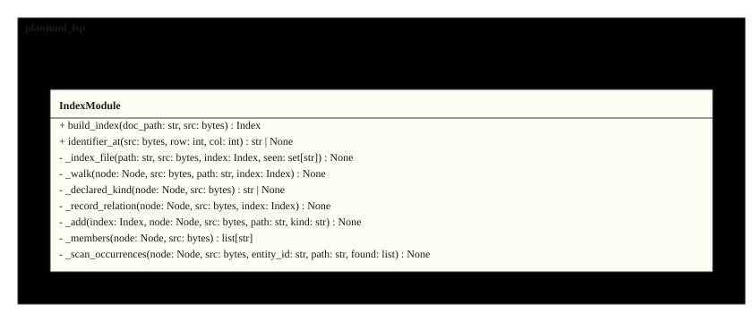
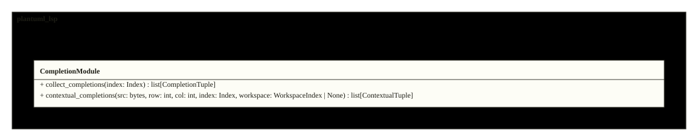
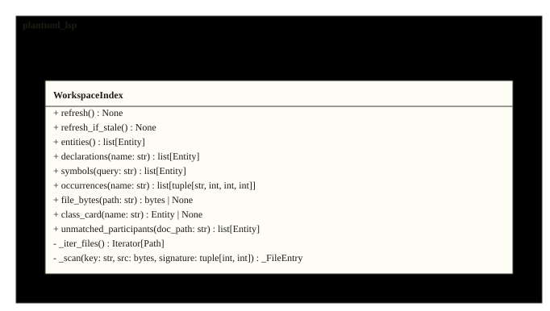
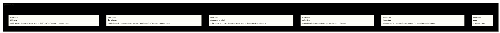

# Architecture

The server is a thin pygls layer over two indexes: the per-document Index
(entities, members, calls over the include closure) and the incremental
WorkspaceIndex (every diagram under the root, correlated by id or display
name). Definitions, completion, lints, hover, references and rename are
pure functions over those two. The figures below are the repository's
actual design, rendered from its sources on every inject.

<!-- folio: design --assets assets -->
### System view

#### HLD_PlantumlLsp

_hld · `design/hld/HLD_PlantumlLsp.puml`_

- traces to: `SREQ-00001-1`

### Module overview

#### CL_PlantumlLsp

_cl · `design/lld/plantuml_lsp/CL_PlantumlLsp.puml`_

- traces to: `REQ-00001-1` `REQ-00002-1` `REQ-00003-1` `REQ-00004-1` `REQ-00005-1` `REQ-00006-1` `REQ-00007-1` `REQ-00008-1` `REQ-00009-1` `REQ-00010-1` `REQ-00011-1` `REQ-00012-1` `REQ-00013-1` `REQ-00014-1`
- implemented in: `src/plantuml_lsp/actions.py` · `src/plantuml_lsp/completion.py` · `src/plantuml_lsp/definitions.py` · `src/plantuml_lsp/diagnostics.py` · `src/plantuml_lsp/hover.py` · `src/plantuml_lsp/index.py` · `src/plantuml_lsp/links.py` · `src/plantuml_lsp/lints.py` · `src/plantuml_lsp/parsing.py` · `src/plantuml_lsp/rename.py` · `src/plantuml_lsp/server.py` · `src/plantuml_lsp/symbols.py` · `src/plantuml_lsp/workspace.py`
- verified by: `tests/test_actions.py` (3) · `tests/test_completion_context.py` (5) · `tests/test_definitions.py` (3) · `tests/test_diagnostics.py` (2) · `tests/test_features_v1.py` (13) · `tests/test_formatting.py` (1) · `tests/test_index.py` (5) · `tests/test_server.py` (1) · `tests/test_symbols.py` (2) · `tests/test_workspace.py` (8)

### Class detail

<code>CL_Parsing</code> · traces to <code>REQ-00001-1</code>

<ul>
<li>source: <code>design/lld/plantuml_lsp/CL_Parsing.puml</code></li>
<li>implemented in: <code>src/plantuml_lsp/parsing.py</code></li>
<li>verified by: <code>tests/test_diagnostics.py</code> (2)</li>
</ul>

<code>CL_Diagnostics</code> · traces to <code>REQ-00001-1</code>

<ul>
<li>source: <code>design/lld/plantuml_lsp/CL_Diagnostics.puml</code></li>
<li>implemented in: <code>src/plantuml_lsp/diagnostics.py</code></li>
<li>verified by: <code>tests/test_diagnostics.py</code> (2)</li>
</ul>

<code>CL_Symbols</code> · traces to <code>REQ-00002-1</code>

<ul>
<li>source: <code>design/lld/plantuml_lsp/CL_Symbols.puml</code></li>
<li>implemented in: <code>src/plantuml_lsp/symbols.py</code></li>
<li>verified by: <code>tests/test_symbols.py</code> (2)</li>
</ul>

<code>CL_Definitions</code> · traces to <code>REQ-00003-1</code> <code>REQ-00011-1</code> <code>REQ-00012-1</code>

<ul>
<li>source: <code>design/lld/plantuml_lsp/CL_Definitions.puml</code></li>
<li>implemented in: <code>src/plantuml_lsp/definitions.py</code></li>
<li>verified by: <code>tests/test_definitions.py</code> (3), <code>tests/test_features_v1.py</code> (4)</li>
</ul>

<code>CL_Entity</code> · traces to <code>REQ-00005-1</code>

<ul>
<li>source: <code>design/lld/plantuml_lsp/CL_Entity.puml</code></li>
<li>implemented in: <code>src/plantuml_lsp/index.py</code></li>
<li>verified by: <code>tests/test_index.py</code> (5)</li>
</ul>

<code>CL_Index</code> · traces to <code>REQ-00005-1</code> <code>REQ-00011-1</code> <code>REQ-00012-1</code>

<ul>
<li>source: <code>design/lld/plantuml_lsp/CL_Index.puml</code></li>
<li>implemented in: <code>src/plantuml_lsp/index.py</code></li>
<li>verified by: <code>tests/test_features_v1.py</code> (4), <code>tests/test_index.py</code> (5)</li>
</ul>

<code>CL_IndexModule</code> · traces to <code>REQ-00005-1</code>

<ul>
<li>source: <code>design/lld/plantuml_lsp/CL_IndexModule.puml</code></li>
<li>implemented in: <code>src/plantuml_lsp/index.py</code></li>
<li>verified by: <code>tests/test_index.py</code> (5)</li>
</ul>

<code>CL_Completion</code> · traces to <code>REQ-00006-1</code> <code>REQ-00013-1</code>

<ul>
<li>source: <code>design/lld/plantuml_lsp/CL_Completion.puml</code></li>
<li>implemented in: <code>src/plantuml_lsp/completion.py</code></li>
<li>verified by: <code>tests/test_completion_context.py</code> (5), <code>tests/test_features_v1.py</code> (4), <code>tests/test_server.py</code> (1)</li>
</ul>

<code>CL_Hover</code> · traces to <code>REQ-00006-1</code>

<ul>
<li>source: <code>design/lld/plantuml_lsp/CL_Hover.puml</code></li>
<li>implemented in: <code>src/plantuml_lsp/hover.py</code></li>
<li>verified by: <code>tests/test_features_v1.py</code> (4), <code>tests/test_server.py</code> (1)</li>
</ul>

<code>CL_Rename</code> · traces to <code>REQ-00006-1</code>

<ul>
<li>source: <code>design/lld/plantuml_lsp/CL_Rename.puml</code></li>
<li>implemented in: <code>src/plantuml_lsp/rename.py</code></li>
<li>verified by: <code>tests/test_features_v1.py</code> (4), <code>tests/test_server.py</code> (1)</li>
</ul>

<code>CL_Links</code> · traces to <code>REQ-00006-1</code>

<ul>
<li>source: <code>design/lld/plantuml_lsp/CL_Links.puml</code></li>
<li>implemented in: <code>src/plantuml_lsp/links.py</code></li>
<li>verified by: <code>tests/test_features_v1.py</code> (4), <code>tests/test_server.py</code> (1)</li>
</ul>

<code>CL_Lints</code> · traces to <code>REQ-00007-1</code> <code>REQ-00011-1</code> <code>REQ-00012-1</code>

<ul>
<li>source: <code>design/lld/plantuml_lsp/CL_Lints.puml</code></li>
<li>implemented in: <code>src/plantuml_lsp/lints.py</code></li>
<li>verified by: <code>tests/test_features_v1.py</code> (8)</li>
</ul>

<code>CL_Actions</code> · traces to <code>REQ-00014-1</code>

<ul>
<li>source: <code>design/lld/plantuml_lsp/CL_Actions.puml</code></li>
<li>implemented in: <code>src/plantuml_lsp/actions.py</code></li>
<li>verified by: <code>tests/test_actions.py</code> (3)</li>
</ul>

<code>CL_Workspace</code> · traces to <code>REQ-00008-1</code> <code>REQ-00009-1</code> <code>REQ-00010-1</code> <code>REQ-00011-1</code>

<ul>
<li>source: <code>design/lld/plantuml_lsp/CL_Workspace.puml</code></li>
<li>implemented in: <code>src/plantuml_lsp/workspace.py</code></li>
<li>verified by: <code>tests/test_features_v1.py</code> (3), <code>tests/test_workspace.py</code> (8)</li>
</ul>

<code>CL_Server</code> · traces to <code>REQ-00001-1</code> <code>REQ-00002-1</code> <code>REQ-00003-1</code> <code>REQ-00004-1</code>

<ul>
<li>source: <code>design/lld/plantuml_lsp/CL_Server.puml</code></li>
<li>implemented in: <code>src/plantuml_lsp/server.py</code></li>
<li>verified by: <code>tests/test_definitions.py</code> (3), <code>tests/test_diagnostics.py</code> (2), <code>tests/test_formatting.py</code> (1), <code>tests/test_symbols.py</code> (2)</li>
</ul>

<!-- /folio -->
