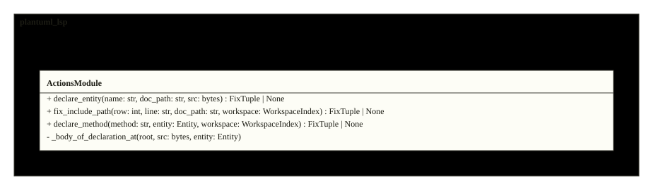
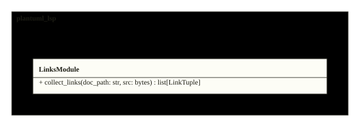
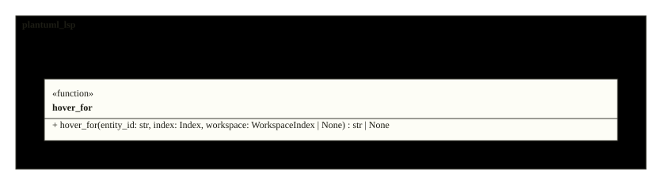
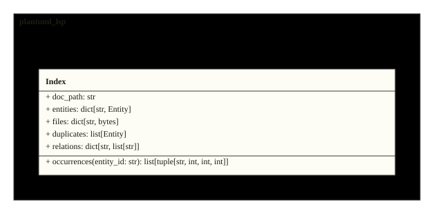
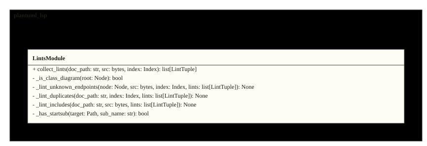
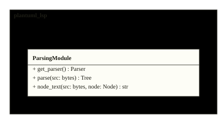
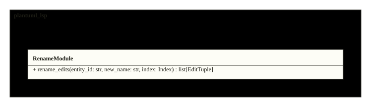
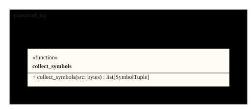

# Architecture

The server is a thin pygls layer over two indexes: the per-document Index
(entities, members, calls over the include closure) and the incremental
WorkspaceIndex (every diagram under the root, correlated by id or display
name). Definitions, completion, lints, hover, references and rename are
pure functions over those two. The figures below are the repository's
actual design, rendered from its sources on every inject.

<!-- folio: design --assets assets -->
### System view

#### HLD_PlantumlLsp

_hld · `design/hld/HLD_PlantumlLsp.puml`_

- traces to: `SREQ-00001-1`

### Module overview

#### CL_Actions

_cl · `design/lld/plantuml_lsp/CL_Actions.puml`_

- traces to: `REQ-00014-1`
- implemented in: `src/plantuml_lsp/actions.py`
- verified by: `tests/integration/test_actions.py` (3) · `tests/integration/test_it_lsp.py` (1)

#### CL_Activities

_cl · `design/lld/plantuml_lsp/correlation/CL_Activities.puml`_

- traces to: `REQ-00012-2`
- implemented in: `src/plantuml_lsp/correlation/activities.py`
- verified by: `tests/integration/test_it_features_v1.py` (2)

#### CL_Context

_cl · `design/lld/plantuml_lsp/completion/CL_Context.puml`_

- traces to: `REQ-00013-2`
- implemented in: `src/plantuml_lsp/completion/context.py`
- verified by: `tests/integration/test_completion_context.py` (5) · `tests/integration/test_it_lsp.py` (1)

#### CL_Core

_cl · `design/lld/plantuml_lsp/server/CL_Core.puml`_

- traces to: `REQ-00021-1`
- implemented in: `src/plantuml_lsp/server/core.py`
- verified by: `tests/integration/test_it_lsp.py` (1) · `tests/integration/test_it_server.py` (1)

#### CL_Correlation

_cl · `design/lld/plantuml_lsp/correlation/CL_Correlation.puml`_

- traces to: `REQ-00016-1`
- implemented in: `src/plantuml_lsp/correlation/activities.py` · `src/plantuml_lsp/correlation/messages.py` · `src/plantuml_lsp/correlation/participants.py`

#### CL_Cursor

_cl · `design/lld/plantuml_lsp/index/CL_Cursor.puml`_

- traces to: `REQ-00005-1`
- implemented in: `src/plantuml_lsp/index/cursor.py`
- verified by: `tests/integration/test_it_index.py` (5)

#### CL_Definitions

_cl · `design/lld/plantuml_lsp/CL_Definitions.puml`_

- traces to: `REQ-00003-1`
- implemented in: `src/plantuml_lsp/definitions.py`
- verified by: `tests/integration/test_definitions.py` (3) · `tests/integration/test_it_lsp.py` (2)

#### CL_Diagnostics

_cl · `design/lld/plantuml_lsp/CL_Diagnostics.puml`_

- traces to: `REQ-00001-1`
- implemented in: `src/plantuml_lsp/diagnostics.py`
- verified by: `tests/integration/test_diagnostics.py` (2) · `tests/integration/test_it_lsp.py` (1)

#### CL_EditorFeatures

_cl · `design/lld/plantuml_lsp/CL_EditorFeatures.puml`_

- traces to: `REQ-00006-1`
- implemented in: `src/plantuml_lsp/completion/context.py` · `src/plantuml_lsp/completion/vocabulary.py` · `src/plantuml_lsp/hover.py` · `src/plantuml_lsp/links.py` · `src/plantuml_lsp/rename.py`

### Class detail

<code>CL_Links</code> · traces to <code>REQ-00020-1</code>

<ul>
<li>source: <code>design/lld/plantuml_lsp/CL_Links.puml</code></li>
<li>implemented in: <code>src/plantuml_lsp/links.py</code></li>
<li>verified by: <code>tests/integration/test_it_features_v1.py</code> (1), <code>tests/integration/test_it_lsp.py</code> (1)</li>
</ul>

### Module overview

#### CL_FileEntry

_cl · `design/lld/plantuml_lsp/workspace/CL_FileEntry.puml`_

- traces to: `REQ-00008-1`
- implemented in: `src/plantuml_lsp/workspace/WorkspaceIndex.py`
- verified by: `tests/integration/test_workspace.py` (3)

#### CL_Hover

_cl · `design/lld/plantuml_lsp/CL_Hover.puml`_

- traces to: `REQ-00018-1`
- implemented in: `src/plantuml_lsp/hover.py`
- verified by: `tests/integration/test_it_features_v1.py` (1) · `tests/integration/test_it_lsp.py` (1)

#### CL_Index

_cl · `design/lld/plantuml_lsp/index/CL_Index.puml`_

- traces to: `REQ-00005-1`
- implemented in: `src/plantuml_lsp/index/Index.py`
- verified by: `tests/integration/test_it_index.py` (5)

#### CL_Lints

_cl · `design/lld/plantuml_lsp/CL_Lints.puml`_

- traces to: `REQ-00007-1`
- implemented in: `src/plantuml_lsp/lints.py`
- verified by: `tests/integration/test_it_features_v1.py` (4)

#### CL_LspCodeActions

_cl · `design/lld/plantuml_lsp/server/CL_LspCodeActions.puml`_

- traces to: `REQ-00014-1`
- implemented in: `src/plantuml_lsp/server/lsp_code_actions.py`
- verified by: `tests/integration/test_actions.py` (3) · `tests/integration/test_it_lsp.py` (1)

#### CL_LspCompletion

_cl · `design/lld/plantuml_lsp/server/CL_LspCompletion.puml`_

- traces to: `REQ-00013-2`
- implemented in: `src/plantuml_lsp/server/lsp_completion.py`
- verified by: `tests/integration/test_completion_context.py` (5) · `tests/integration/test_it_lsp.py` (1)

#### CL_LspDefinition

_cl · `design/lld/plantuml_lsp/server/CL_LspDefinition.puml`_

- traces to: `REQ-00003-1`
- implemented in: `src/plantuml_lsp/server/lsp_definition.py`
- verified by: `tests/integration/test_definitions.py` (3) · `tests/integration/test_it_lsp.py` (2)

#### CL_LspDiagnostics

_cl · `design/lld/plantuml_lsp/server/CL_LspDiagnostics.puml`_

- traces to: `REQ-00001-1`
- implemented in: `src/plantuml_lsp/server/lsp_diagnostics.py`
- verified by: `tests/integration/test_diagnostics.py` (2) · `tests/integration/test_it_lsp.py` (1)

#### CL_LspFormatting

_cl · `design/lld/plantuml_lsp/server/CL_LspFormatting.puml`_

- traces to: `REQ-00004-1`
- implemented in: `src/plantuml_lsp/server/lsp_formatting.py`
- verified by: `tests/integration/test_formatting.py` (1) · `tests/integration/test_it_lsp.py` (1)

#### CL_LspHover

_cl · `design/lld/plantuml_lsp/server/CL_LspHover.puml`_

- traces to: `REQ-00018-1`
- implemented in: `src/plantuml_lsp/server/lsp_hover.py`
- verified by: `tests/integration/test_it_features_v1.py` (1) · `tests/integration/test_it_lsp.py` (1)

#### CL_LspLinks

_cl · `design/lld/plantuml_lsp/server/CL_LspLinks.puml`_

- traces to: `REQ-00020-1`
- implemented in: `src/plantuml_lsp/server/lsp_links.py`
- verified by: `tests/integration/test_it_features_v1.py` (1) · `tests/integration/test_it_lsp.py` (1)

#### CL_LspReferences

_cl · `design/lld/plantuml_lsp/server/CL_LspReferences.puml`_

- traces to: `REQ-00019-1`
- implemented in: `src/plantuml_lsp/server/lsp_references.py`
- verified by: `tests/integration/test_it_features_v1.py` (1) · `tests/integration/test_it_lsp.py` (1)

#### CL_LspSymbols

_cl · `design/lld/plantuml_lsp/server/CL_LspSymbols.puml`_

- traces to: `REQ-00002-1`
- implemented in: `src/plantuml_lsp/server/lsp_symbols.py`
- verified by: `tests/integration/test_it_lsp.py` (1) · `tests/integration/test_symbols.py` (2)

#### CL_LspWorkspaceSymbols

_cl · `design/lld/plantuml_lsp/server/CL_LspWorkspaceSymbols.puml`_

- traces to: `REQ-00009-1`
- implemented in: `src/plantuml_lsp/server/lsp_workspace_symbols.py`
- verified by: `tests/integration/test_it_features_v1.py` (1) · `tests/integration/test_it_lsp.py` (1) · `tests/integration/test_workspace.py` (4)

#### CL_Messages

_cl · `design/lld/plantuml_lsp/correlation/CL_Messages.puml`_

- traces to: `REQ-00011-2`
- implemented in: `src/plantuml_lsp/correlation/messages.py`
- verified by: `tests/integration/test_it_features_v1.py` (2) · `tests/integration/test_it_lsp.py` (1)

#### CL_Occurrences

_cl · `design/lld/plantuml_lsp/index/CL_Occurrences.puml`_

- traces to: `REQ-00005-1`
- implemented in: `src/plantuml_lsp/index/occurrences.py`
- verified by: `tests/integration/test_it_index.py` (5)

#### CL_Participants

_cl · `design/lld/plantuml_lsp/correlation/CL_Participants.puml`_

- traces to: `REQ-00010-2`
- implemented in: `src/plantuml_lsp/correlation/participants.py`
- verified by: `tests/integration/test_it_lsp.py` (1) · `tests/integration/test_workspace.py` (1)

#### CL_PlantumlLsp

_cl · `design/lld/plantuml_lsp/CL_PlantumlLsp.puml`_

- traces to: `REQ-00001-1` `REQ-00002-1` `REQ-00003-1` `REQ-00004-1` `REQ-00005-1` `REQ-00006-1` `REQ-00007-1` `REQ-00008-1` `REQ-00009-1` `REQ-00010-2` `REQ-00013-2` `REQ-00014-1` `REQ-00015-1` `REQ-00011-2` `REQ-00012-2` `REQ-00016-1` `REQ-00017-1` `REQ-00018-1` `REQ-00019-1` `REQ-00020-1` `REQ-00021-1`
- implemented in: `src/plantuml_lsp/actions.py` · `src/plantuml_lsp/completion/context.py` · `src/plantuml_lsp/completion/vocabulary.py` · `src/plantuml_lsp/correlation/activities.py` · `src/plantuml_lsp/correlation/messages.py` · `src/plantuml_lsp/correlation/participants.py` · `src/plantuml_lsp/definitions.py` · `src/plantuml_lsp/diagnostics.py` · `src/plantuml_lsp/hover.py` · `src/plantuml_lsp/index/Entity.py` · `src/plantuml_lsp/index/Index.py` · `src/plantuml_lsp/index/cursor.py` · `src/plantuml_lsp/index/occurrences.py` · `src/plantuml_lsp/links.py` · `src/plantuml_lsp/lints.py` · `src/plantuml_lsp/parsing.py` · `src/plantuml_lsp/rename.py` · `src/plantuml_lsp/server/core.py` · `src/plantuml_lsp/server/lsp_code_actions.py` · `src/plantuml_lsp/server/lsp_completion.py` · `src/plantuml_lsp/server/lsp_definition.py` · `src/plantuml_lsp/server/lsp_diagnostics.py` · `src/plantuml_lsp/server/lsp_formatting.py` · `src/plantuml_lsp/server/lsp_hover.py` · `src/plantuml_lsp/server/lsp_links.py` · `src/plantuml_lsp/server/lsp_references.py` · `src/plantuml_lsp/server/lsp_symbols.py` · `src/plantuml_lsp/server/lsp_workspace_symbols.py` · `src/plantuml_lsp/symbols.py` · `src/plantuml_lsp/workspace/WorkspaceIndex.py`
- verified by: `tests/integration/test_actions.py` (3) · `tests/integration/test_completion_context.py` (5) · `tests/integration/test_definitions.py` (3) · `tests/integration/test_diagnostics.py` (2) · `tests/integration/test_formatting.py` (1) · `tests/integration/test_it_features_v1.py` (13) · `tests/integration/test_it_index.py` (5) · `tests/integration/test_it_lsp.py` (14) · `tests/integration/test_it_server.py` (1) · `tests/integration/test_symbols.py` (2) · `tests/integration/test_workspace.py` (8)

### Class detail

<code>CL_Parsing</code> · traces to <code>REQ-00015-1</code>

<ul>
<li>source: <code>design/lld/plantuml_lsp/CL_Parsing.puml</code></li>
<li>implemented in: <code>src/plantuml_lsp/parsing.py</code></li>
</ul>

<code>CL_Entity</code> · traces to <code>REQ-00005-1</code>

<ul>
<li>source: <code>design/lld/plantuml_lsp/index/CL_Entity.puml</code></li>
<li>implemented in: <code>src/plantuml_lsp/index/Entity.py</code></li>
<li>verified by: <code>tests/integration/test_it_index.py</code> (5)</li>
</ul>

### Module overview

#### CL_Rename

_cl · `design/lld/plantuml_lsp/CL_Rename.puml`_

- traces to: `REQ-00019-1`
- implemented in: `src/plantuml_lsp/rename.py`
- verified by: `tests/integration/test_it_features_v1.py` (1) · `tests/integration/test_it_lsp.py` (1)

#### CL_Symbols

_cl · `design/lld/plantuml_lsp/CL_Symbols.puml`_

- traces to: `REQ-00002-1`
- implemented in: `src/plantuml_lsp/symbols.py`
- verified by: `tests/integration/test_it_lsp.py` (1) · `tests/integration/test_symbols.py` (2)

#### CL_Vocabulary

_cl · `design/lld/plantuml_lsp/completion/CL_Vocabulary.puml`_

- traces to: `REQ-00017-1`
- implemented in: `src/plantuml_lsp/completion/vocabulary.py`
- verified by: `tests/integration/test_it_features_v1.py` (1)

#### CL_WorkspaceIndex

_cl · `design/lld/plantuml_lsp/workspace/CL_WorkspaceIndex.puml`_

- traces to: `REQ-00008-1`
- implemented in: `src/plantuml_lsp/workspace/WorkspaceIndex.py`
- verified by: `tests/integration/test_workspace.py` (3)

<!-- /folio -->
